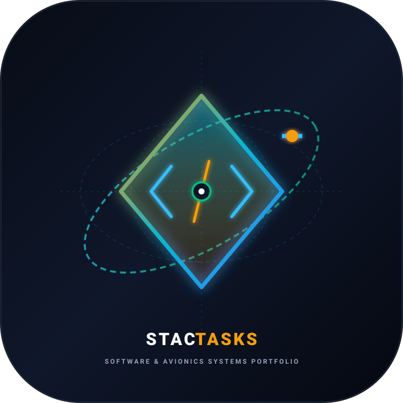
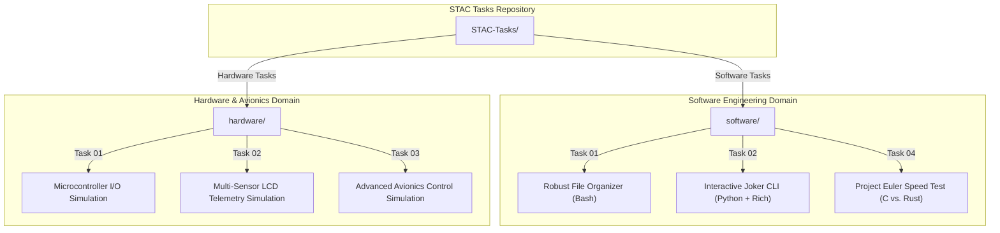

<p align="center">
  
</p>

<h1 align="center">STAC Tasks</h1>

<p align="center">
  <strong>Student Technical Activities Club (STAC) Engineering Portfolio &amp; Avionics Systems Sandbox.</strong>
</p>

<p align="center">
  <a href="LICENSE"></a>
  
  
  
  <a href="future.md"></a>
</p>

---

## ⚡ Overview

**STAC Tasks** is a dual-track technical engineering repository spanning both **Software Engineering** and **Hardware & Avionics Simulation**, built for rigorous systems analysis and embedded control.

---

## 🏗️ Domain Architecture



---

## 💻 Software Engineering Domain

### 1. Robust File Segregator (`software/Task-01`)
*   **Concept:** A defensive file organization script (`segrV2.sh`) that dynamically parses folders and sorts untidy files into category folders based on their extensions.
*   **Categories:** `Imgs/` (`jpg`, `png`, `webp`), `Docs/` (`pdf`, `docx`, `txt`, `md`), `Music/` (`mp3`, `wav`, `opus`), and `Misc/`.
*   **Defensive Features:** Utilizes `mkdir -p` to prevent directory re-creation errors, explicitly ignores the script file (`segrV2.sh`) to prevent self-deletion, and handles whitespace in paths safely.

### 2. Joker Command Line Interface (`software/Task-02`)
*   **Concept:** An interactive console terminal script (`joker.py`) that queries remote APIs to fetch, format, and display jokes.
*   **Technologies:** Python `requests` with strict content safety parameters and the `rich` CLI library for terminal formatting.
*   **Resilience:** Catches offline network exceptions gracefully.

### 3. Project Euler Systems Analysis (`software/Task-04`)
*   **Concept:** Implements Project Euler Problems 1 through 5 in both C (Clang) and Rust (Cargo) to benchmark compilation speed, runtime latency, and CPU footprint.
*   **Takeaway:** Analyzes the trade-offs between C's raw execution speed and Rust's memory safety guarantees.

---

## 🎛️ Hardware & Avionics Domain

The hardware section contains low-level flight and circuit simulations recorded in high-fidelity `.mp4` video captures:

*   **Task 01: Core Microcontroller Digital I/O Control (`hardware/Task-01`)**
    *   *Simulation:* `Sim-2025-09-08_23.22.47.mp4`
    *   *Details:* Covers basic microcontroller operations, digital pin actuation, and Pulse-Width Modulation (PWM) for low-level actuators.
*   **Task 02: Multi-Sensor & Telemetry Display Integration (`hardware/Task-02`)**
    *   *Simulation:* `Sim-2025-09-09_00.02.33.mp4`
    *   *Details:* Interfacing environmental telemetry sensors (such as Ultrasonic distance meters) with visual liquid crystal displays (LCD).
*   **Task 03: Closed-Loop Avionics & Steering Control (`hardware/Task-03`)**
    *   *Simulation:* `Sim-2025-09-09_23.16.37.mp4`
    *   *Details:* Simulates closed-loop motor systems modeling drone steering and rover navigation.

---

## 🚀 Quick Execution Guide (Software Track)

### 1. Run the File Organizer
```bash
cd software/Task-01
chmod +x segrV2.sh
./segrV2.sh
```

### 2. Launch the Joker CLI
```bash
cd software/Task-02
pip install requests rich
python joker.py
```

### 3. Build Project Euler Solutions (C/Rust)
```bash
cd software/Task-04
# Compile C programs
gcc Euler-Prob1.c -o prob1
./prob1

# Run Rust project
cd Euler-Prob3
cargo run --release
```

---

## 🔮 Engineering Roadmap

To explore planned features including automated Wokwi/QEMU simulation harnesses, bare-metal `no_std` Rust embedded firmware, and STAC satellite imagery processing, read [future.md](future.md).

---

## 📄 License

Licensed under the **MIT License**. See `LICENSE` for details.
